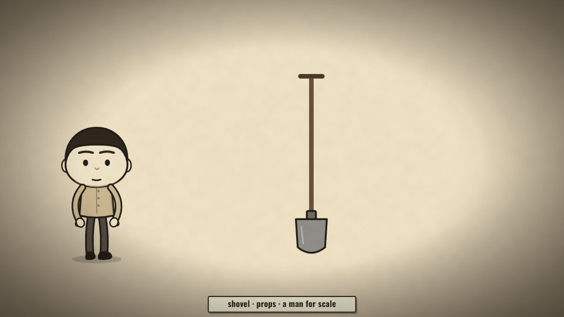

# Library index

Generated by `python tools/lib.py index`. Do not edit by hand. Search it: `python tools/lib.py search "words"`.

**library** = made for a film and kept (vector drawings, costume pieces, places, plates, weather presets).
**builtin** = drawn by the engine code (props, vehicles, presets, sets, kit styles and modules, look options).

## props

_things people hold or that stand on floors and tables (a broom, a lectern, a notice board, a shovel)_

| id | what | tags | made in | preview |
|---|---|---|---|---|
| `notice_board` | a notice board on two legs with pinned notices (ration announcements, call-up orders, casualty lists) — set "text" on the card's paper_note for the exact words | notice, board, poster, town, ration, announcement | creative-blockade |  |
| `shovel` | a long-handled shovel for digging trenches and gun pits (held in both hands; drawn around the hand) | tool, dig, entrenching, army, trench, ww1, ww2 | _libtest |  |

Builtin (102): `baby`, `bale`, `barrel`, `basket`, `bench`, `binoculars`, `bomb`, `book`, `bottle`, `bowl`, `bread`, `bucket`, `candle`, `card`, `cards`, `cart`, `chair`, `cigar`, `clock`, `coins`, `counter`, `crate`, `cross`, `cup`, `exit`, `factory`, `flag`, `folder`, `globe`, `grave`, `helmet`, `hourglass`, `ingots`, `jug`, `knife`, `lantern`, `ledger`, `letter`, `magnifier`, `medal`, `microphone`, `oil`, `paper`, `pen`, `phone`, `photo`, `plate`, `pot`, `potatoes`, `radio`, `rifle`, `sack`, `scale`, `shell`, `sign`, `skull`, `spoon`, `stool`, `stopwatch`, `stove`, `stretcher`, `suitcase`, `table`, `telegram`, `turnip`, `turnips`, `typewriter`, `room_item_window`, `room_item_door`, `room_item_shelf`, `room_item_cupboard`, `room_item_cabinet`, `room_item_drawers`, `room_item_stove`, `room_item_fireplace`, `room_item_oven`, `room_item_bed`, `room_item_beds`, `room_item_bunk`, `room_item_clock`, `room_item_portrait`, `room_item_map`, `room_item_poster`, `room_item_flag`, `room_item_calendar`, `room_item_photos`, `room_item_crucifix`, `room_item_mirror`, `room_item_hooks`, `room_item_lamp`, `room_item_barrels`, `room_item_crates`, `room_item_sacks`, `room_item_rifles`, `room_item_blackboard`, `room_item_sink`, `room_item_cradle`, `room_item_arch`, `room_item_stained`, `room_item_sign`, `room_item_radio`, `room_item_pipes`

## vehicles

_things that move with wheels, tracks, hulls or wings (a bicycle, a cart, a field kitchen, an airship)_

| id | what | tags | made in | preview |
|---|---|---|---|---|
| `bicycle` | a bicycle standing on its stand (messengers, a soldier's or a nurse's bike, a village policeman) | bicycle, bike, cycle, messenger, village, civilian | creative-blockade |  |
| `field_kitchen` | army field kitchen (a two-wheeled wagon with a soup kettle and a smoking chimney): soup queues, cooks at the front, soup kitchens at home | ww1, ww2, army, kitchen, wagon, soup, cook | creative-blockade |  |
| `zeppelin` | WW1 airship (Zeppelin) — a thing in the sky: place it with "y" (screen y, e.g. 260) and "scale" (0.5-1.2); "to" makes it drift across | ww1, airship, zeppelin, sky, germany, bombing | creative-blockade |  |

Builtin (39): `artillery`, `assaultboat`, `battleship`, `boat`, `bomber`, `car`, `cargo`, `carrier`, `cart`, `cruiser`, `dakota`, `destroyer`, `divebomber`, `fighter`, `freighter`, `glider`, `gun`, `halftrack`, `horse`, `jeep`, `locomotive`, `markiv`, `panther`, `panzer4`, `plane`, `renault`, `sherman`, `stug`, `submarine`, `t34`, `tank`, `tank_flat`, `tiger`, `train`, `traincar`, `transport`, `truck`, `uboat`, `wagon`

## buildings

_houses, shops, huts, temples, bunkers: whole buildings placed in a street or a landscape_

Builtin (10): `kit_house`, `kit_tenement`, `kit_shop`, `kit_church`, `kit_townhall`, `kit_factory`, `kit_office`, `kit_post`, `kit_ruin`, `kit_station`

## plants

_trees, palms, bushes, grass clumps, crops (they sway in the wind)_

## costumes

_pieces people wear: hats, turbans, headscarves, sarongs, tunics, vests (drawn on the character rig)_

Builtin (72): `outfit_tunic`, `outfit_suit`, `outfit_navy`, `outfit_navywhite`, `outfit_coat`, `outfit_sailor`, `outfit_civil`, `outfit_dress`, `outfit_party`, `outfit_armor`, `outfit_robe`, `outfit_pilot`, `outfit_tweed`, `hair_side`, `hair_back`, `hair_bald`, `hair_baldtop`, `hair_short`, `hair_part`, `hair_curly`, `hair_bun`, `hair_long`, `hair_messy`, `hair_tousled`, `hair_none`, `facial_toothbrush`, `facial_walrus`, `facial_pencil`, `facial_handlebar`, `facial_beard`, `facial_goatee`, `facial_stubble`, `facial_none`, `hat_peaked`, `hat_garrison`, `hat_helmet_de`, `hat_helmet_us`, `hat_helmet_uk`, `hat_helmet_su`, `hat_helmet_jp`, `hat_navy`, `hat_navy_white`, `hat_beret`, `hat_bicorne`, `hat_kepi`, `hat_ushanka`, `hat_fedora`, `hat_tophat`, `hat_pith`, `hat_sailor`, `hat_pilot`, `hat_roman`, `hat_crown`, `hat_flatcap`, `hat_none`, `glasses_round`, `glasses_pince`, `glasses_sun`, `glasses_none`, `extra_cigar`, `extra_pipe`, `extra_medals`, `extra_armband`, `extra_epaulettes`, `extra_tie`, `extra_bowtie`, `extra_scarf`, `extra_monocle`, `extra_wrinkles`, `extra_jowls`, `extra_blush`, `extra_vest`

## characters

_ready cast looks: a preset + costume pieces + colours (a Malay villager, a Sikh soldier)_

Builtin (141): `aide`, `american_pilot`, `american_sailor`, `american_soldier`, `bauer`, `bedell_smith`, `beria`, `bernhard`, `bittrich`, `brereton`, `brian_urquhart`, `british_para`, `british_para_helmet`, `british_soldier`, `browning`, `brusilov`, `caesar`, `chamberlain`, `chiang`, `chill`, `churchill`, `civilian_man`, `civilian_woman`, `cunningham`, `currie`, `de_gaulle`, `diplomat`, `dutch_civilian`, `dutch_woman`, `eisenhower`, `ernest_archer`, `falkenhayn`, `finnish_soldier`, `foch`, `french_soldier`, `frost`, `gallieni`, `gamelin`, `gavin`, `german_officer`, `german_pilot`, `german_soldier`, `german_tanker`, `goebbels`, `goering`, `grabner`, `guards_tanker`, `guderian`, `halder`, `halifax`, `hannibal`, `harmel`, `harmel_old`, `himmler`, `hindenburg`, `hirohito`, `hitler`, `hitler_uniform`, `holtzendorff`, `horrocks`, `host`, `host_field`, `host_old_style`, `host_winter`, `italian_soldier`, `japanese_officer`, `japanese_pilot`, `japanese_sailor`, `japanese_soldier`, `jellicoe`, `joffre`, `julian_cook`, `kaiser`, `kaiser_wilhelm`, `khrushchev`, `kluck`, `krafft`, `kutuzov`, `lanrezac`, `lenin`, `lindemans`, `lindquist`, `ludendorff`, `macarthur`, `mannerheim`, `manstein`, `model`, `molotov`, `moltke`, `monash`, `montgomery`, `mussolini`, `nagumo`, `napoleon`, `narrator_accountant`, `narrator_archivist`, `nimitz`, `patton`, `paulus`, `petain`, `pinto`, `polish_para`, `polish_soldier`, `raf_pilot`, `reporter`, `roman_legionary`, `rommel`, `roosevelt`, `roy_urquhart`, `scheer`, `schlieffen`, `sosabowski`, `soviet_officer`, `soviet_soldier`, `soviet_winter`, `ss_soldier`, `stalin`, `tojo`, `truman`, `uboat_captain`, `us_navy_officer`, `us_para`, `vn_peasant`, `vn_soldier`, `wellington`, `wilson`, `worker`, `ww1_american`, `ww1_australian`, `ww1_austrian`, `ww1_british`, `ww1_french`, `ww1_french_1914`, `ww1_german`, `ww1_german_1914`, `ww1_russian`, `ww1_sailor_de`, `ww1_sailor_uk`, `yamamoto`, `zhukov`, `zimmermann`

## places

_story places: a room or town from the kit, or a composed landscape (sky + plates + ground + rows of assets)_

Builtin (97): `air`, `airfield`, `archbridge`, `barbed`, `beach`, `board`, `branches`, `bridge`, `bunker`, `cabin`, `cabinet`, `cell`, `city`, `classroom`, `cockpit`, `codebreak`, `conference`, `corridor`, `countryside`, `curtain`, `dark`, `deck`, `desert`, `desk`, `dock`, `doorframe`, `factory`, `field`, `flightdeck`, `frontdesk`, `garden`, `grass`, `hangar`, `harbor`, `heath`, `home`, `hotel`, `jungle`, `kitchen`, `memorial`, `mud`, `nomansland`, `ocean`, `office`, `officedesk`, `paper`, `parliament`, `plant`, `podium`, `polder`, `radio`, `rail`, `railway`, `rally`, `river`, `ruins`, `sandbags`, `sea`, `sky`, `snow`, `station`, `steppe`, `street`, `studio`, `study`, `tent`, `train_interior`, `trench`, `void`, `warroom`, `workshop`, `room_kitchen`, `room_tenement`, `room_parlour`, `room_farmhouse`, `room_shop`, `room_bakery`, `room_office`, `room_ministry`, `room_admiralty`, `room_food_office`, `room_ward`, `room_barracks`, `room_dugout`, `room_cellar`, `room_warehouse`, `room_classroom`, `room_church`, `room_tavern`, `town_german`, `town_austrian`, `town_french`, `town_english`, `town_russian`, `town_dutch`, `town_industrial`, `town_village`

## plates

_painted FAR background layers (sky, far hills, mid distance); never for things near people_

## weather

_weather and atmosphere presets (rain, fog, haze, dust, snow…) with their parameters_

Builtin (2): `rain`, `snow`

